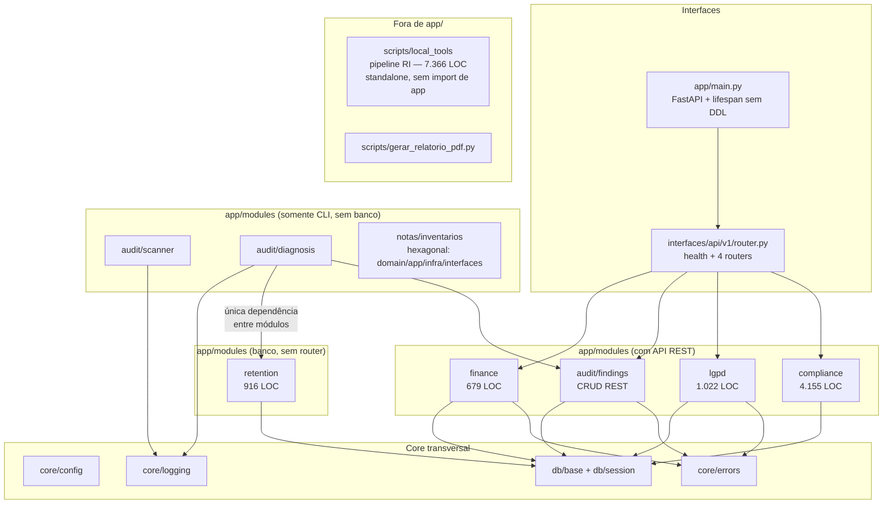
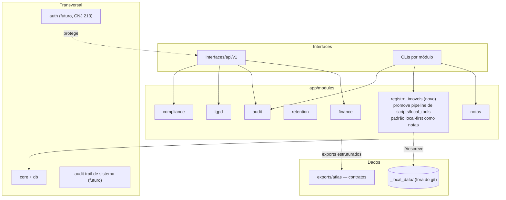

# 02 — Diagnóstico Arquitetural

> Sprint **CARTORIO-REPOSITORY-REBASELINE-1** — 2026-07-09.
> Arquitetura reconstruída a partir do código, dos imports e dos testes — não da documentação.

---

## 1. Arquitetura real (evidência: mapa completo de imports `from app.*`)

**Módulos placeholder vazios (apenas `__init__.py`):** `clients`, `documents`, `exports`, `protocols`, `reports`, `tasks` — declarados intencionais em `docs/architecture.md`.

---

## 2. Mapa por módulo

| Módulo | Responsabilidade | Arquivos-chave | Dep. internas | Contratos públicos | Testes | Maturidade | Riscos |
|--------|-----------------|----------------|---------------|--------------------|--------|-----------|--------|
| `core` + `db` | Settings, erros, logging, engine/session | config.py, errors.py, session.py, base.py | — | `get_settings`, `get_db`, `CartorioException` | via suíte | Madura | Nenhum relevante |
| `finance` | Lançamentos financeiros + resumo mensal | models, rules, service, router | core, db | REST `/api/v1/finance/*` | test_finance_entries (44) | Madura, congelada (backlog) | Sem fechamento mensal (planejado) |
| `audit/scanner` | Inventário read-only de arquivos + hashes | file_scanner.py, cli.py, report.py | core | CLI `python -m app.modules.audit.scanner.cli` | test_file_scanner | Madura, validada em ambiente real | 1 teste skipif no Windows (chmod) |
| `audit/findings` | CRUD de achados de auditoria (sem DELETE físico) | models, service, router | core, db | REST `/api/v1/...findings` | test_audit_findings (43) | Madura | — |
| `audit/diagnosis` | Diagnóstico documental sobre artefatos do scanner (D-23) | rules.py (37 KB), analyzer, temp_rules, cli | audit/findings.enums, **retention** | CLI + relatórios | test_document_diagnosis (39) + temp + integração | Madura, calibrada pós-uso real | Acopla audit→retention (ver §4) |
| `lgpd` | Ações LGPD (AC-01..25), import CSV INOVA, histórico | models, service, router | core, db | REST `/api/v1/lgpd/*` | test_lgpd_actions (37) | Madura | — |
| `retention` | Regras de temporalidade documental + avaliação | models, repository, rules, service, seed | db | Serviço interno + seed; **sem router** | test_retention_* | Funcional | Sem exposição REST (aparentemente intencional; não confirmado) |
| `compliance` | Matriz INOVA v1, evidências, vínculos req↔achado, status indicativo | service.py (30 KB), seed_data/matriz_v1.py (50 KB) | core, db | REST `/api/v1/compliance/*` | 14 arquivos de teste | Madura (4 sprints) | Seed grande em .py (aceitável, versionado) |
| `notas/inventarios` | Minuta-base determinística de inventário extrajudicial | calculator, renderer (35 KB), validator, odt_exporter, cli | — (autocontido, sem banco) | CLI + golden files | 7 arquivos de teste + golden | Madura | Divergência renderer ↔ template .j2 espelho (TD-12); frações truncadas (rota manual §15, proposta FRACOES-1) |
| `scripts/local_tools` (pipeline RI) | Extração/sanitização/análise/consolidação IERI-e/SIG-RI | 7 ferramentas, 7.366 LOC | **nenhuma** (não importa `app`) | CLIs locais anti-PII | 6 arquivos de teste (~334 testes) | Funcional, testada | Fora da arquitetura modular (TD-06) |

---

## 3. Pontos verificados (checklist da sprint)

| Verificação | Resultado |
|-------------|-----------|
| Dependências circulares | **Nenhuma** encontrada no grafo de imports |
| Imports cruzando fronteiras | **1 caso**: `audit/diagnosis/temp_rules.py` → `retention` (rules, enums, models). Direcional, documentado por teste de integração dedicado (`test_diagnosis_retention_integration.py`). Sem ADR formal registrando a exceção |
| Regras de negócio em endpoints | Não — routers delegam a `service.py`; regras cruzadas em `rules.py` (padrão D-09) |
| Regras de negócio em scripts | **Sim — pipeline RI inteiro** (classificação de natureza de imóvel, reconciliação, consolidação) vive em `scripts/local_tools/`. Testado, mas fora de `app/` |
| Repositories com commit próprio | `retention/repository.py` é o único repository; sessões controladas por chamador/fixture — sem commits inconsistentes detectados na leitura |
| Duplicação de schemas/models | Não detectada |
| Constantes espalhadas / config fixa | Configuração centralizada em `core/config.py` (pydantic-settings); `alembic.ini` tem URL SQLite fixa **mas** `env.py` a sobrescreve com `settings.database_url` — sem risco real |
| Caminhos absolutos hardcoded | **Nenhum** em `app/` e `scripts/` |
| Acoplamento com Atlas | **Zero** — nenhuma referência de código; `exports/atlas/` vazio com `.gitkeep` |
| Compartilhamento de banco/credenciais | Não — SQLite local próprio; sem credenciais no repo |
| DDL em runtime | Não — lifespan documenta e cumpre "Alembic é a única fonte de DDL"; `create_all` só em fixture de teste (in-memory) |
| Funcionalidade documentada sem implementação | knowledge_base, document_registry, ai_gateway (blueprints explícitos "sem código" — corretos); **auth multiusuário** (antecipada no roadmap CNJ, não iniciada) |
| Funcionalidade implementada sem documentação adequada | Pipeline RI (docs dizem "pré-implementação"); módulo `notas` ausente da tabela de módulos do `CLAUDE.md` e do índice `docs/README.md` |

---

## 4. Desvios e tensões arquiteturais

1. **Dois padrões de módulo coexistem sem decisão registrada.** `finance/lgpd/retention/compliance/audit.findings` seguem layout flat (`enums/models/rules/schemas/service/router`); `notas/inventarios` introduziu layout hexagonal (`domain/application/infrastructure/interfaces`). Ambos são internamente consistentes e bem testados; o problema é a ausência de ADR dizendo quando usar qual (TD-08).
2. **`audit.diagnosis → retention`** é a única dependência entre módulos. Funciona e é testada, mas contraria a regra "referência fraca, nunca import direto" aplicada no eixo compliance (ADR-002). Merece ADR formal legitimando (é leitura de heurísticas, não FK) ou refatoração futura.
3. **Pipeline RI fora de `app/`.** Maior bolsão de lógica de negócio do repositório (7,4 mil LOC) vive em `scripts/local_tools/`. Coerente com a política de dados locais (opera sobre `_local_data/`, nunca versionado), mas: (a) não aparece na arquitetura documentada; (b) `docs/modules/registro_imoveis.md` reserva o módulo `app/modules/registro_imoveis/` que nunca nasceu; (c) convive na mesma pasta `scripts/` com um gerador de PDF one-off de natureza completamente diferente.
4. **`retention` sem interface.** Único módulo com banco e sem router — consumido apenas por `audit.diagnosis` e seeds. Aparentemente intencional (não confirmado em documento).
5. **Tratamento de erros e logging** são consistentes (exceção única `CartorioException` + handler 500 com traceback + logging stdout). Não há métricas nem trilha de auditoria de sistema (audit trail de mutações) — requisito estrutural do CNJ 213 ainda não iniciado.

---

## 5. Arquitetura-alvo proposta (recomendação — não executar nesta sprint)

Mudanças propostas em relação ao real (detalhe em `05_BLUEPRINT_REPOSITORIO_ALVO.md`):
- promover o pipeline RI a `app/modules/registro_imoveis/` (ou, alternativamente, formalizar `tools/` com contrato próprio — decisão humana);
- registrar por ADR o padrão de layout de módulo (flat × hexagonal) e a exceção `diagnosis→retention`;
- remover (ou preencher) os 6 placeholders vazios conforme o roadmap reconciliado;
- separar `scripts/` de ferramenta local × gerador de artefato de sprint;
- introduzir `auth` e trilha de auditoria como módulos transversais quando a etapa funcional for retomada.

A arquitetura real atual **adere bem** ao desenho original (independência do Atlas, módulos autocontidos, Alembic-only DDL, read-only first). Os desvios são de organização e registro de decisão, não de acoplamento.
